# The Architecture Is Old.

# The Computational Actor Is New.

*C++HDL, AI agents, and moving the RTL development loop while keeping SystemVerilog at the boundary*

<table><tbody>
<tr><th><strong>Author and collaboration</strong> Brad Pierce in collaboration with an AI language model</th></tr>
</tbody></table>

<table><tbody>
<tr><th><strong>Contribution statement</strong> Brad supplied the originating questions, professional context, intended audience, substantive judgments about attribution and scope, and final editorial authority. An AI language model materially assisted with research, synthesis, argument development, drafting, source checking, diagrams, adversarial and target-reader review, and document design. Brad is responsible for approving the final content. This collaboration does not imply endorsement by any organization.</th></tr>
</tbody></table>

### Abstract

These are some thoughts inspired by Mike Reznikov’s recent paper “Designing RTL with C++HDL” [1]. C++HDL revisits a long lineage of executable C/C++ RTL, HDL generation, and cross-domain checking [9,13–17], but does so at a new moment: AI coding agents can now sit inside the fast edit-compile-test loop [3,4]. The central hypothesis is that this new computational actor may change the economics of an old architectural pattern by increasing trustworthy correction and design-space search per unit cost, while SystemVerilog remains the downstream compatibility and verification boundary. We propose experiments that attack the C++HDL/SystemVerilog semantic boundary, compare against a strong SystemVerilog + Verilator baseline [33], decompose representation from native-execution effects, test downstream PPA consequences, and separate migration from maintenance. The aim is not to claim that C++ has become a better HDL, but to define a falsifiable research program for asking whether an old architecture has acquired a new reason to matter.

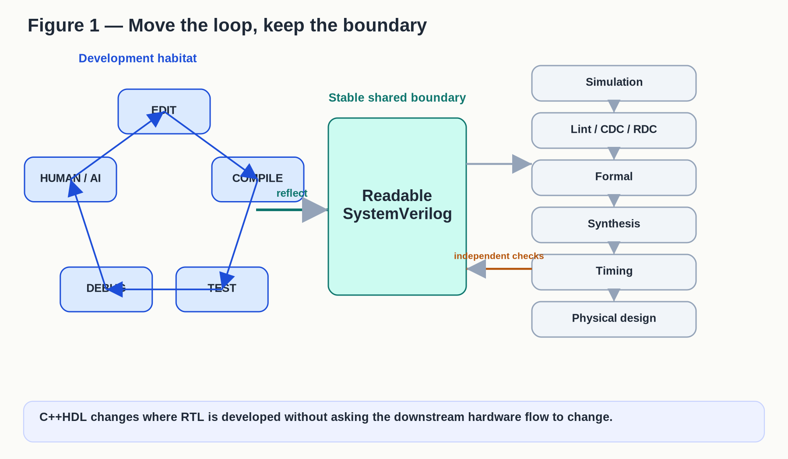

<figure id="figure-1"><figcaption>Figure 1 — Move the loop, keep the boundary</figcaption>
<a href="figures/figure-1.svg">Vector source</a>

Published figure text
<ul><li>Figure 1 — Move the loop, keep the boundary</li><li>Development habitat</li><li>EDIT</li><li>COMPILE</li><li>TEST</li><li>DEBUG</li><li>HUMAN / AI</li><li>Readable</li><li>SystemVerilog</li><li>Stable shared boundary</li><li>Simulation</li><li>Lint / CDC / RDC</li><li>Formal</li><li>Synthesis</li><li>Timing</li><li>Physical design</li><li>reflect</li><li>independent checks</li><li>C++HDL changes where RTL is developed without asking the downstream hardware flow to change.</li></ul>
</figure>

Figure 1. C++HDL changes where RTL is developed without asking the downstream hardware flow to change.

Mike Reznikov’s “Designing RTL with C++HDL” is interesting precisely because its core architectural pattern is not new [1]. By 2000, C Level Design’s System Compiler could take C or C++ hardware descriptions into RTL Verilog or VHDL, while CycleC supplied a cycle-accurate coding style intended for fast native execution [9,22]. In 2002, a DAC paper described an RTL C/C++ flow with bit-accurate C as design entry, automatic HDL generation, and formal equivalence checking between the C-based RTL and generated Verilog [13].

Here, “architecture” is deliberate compression for a recurring family of approaches, not a claim that CycleC, C2Verilog, Clearwater RTL-C, ArchHDL, and C++HDL were technically identical.

C/C++ RTL is old. Fast native execution is old. C/C++-to-HDL translation is old. Even the idea of checking a C-based RTL source against generated Verilog has serious precedent [13–17]. So why does this architecture deserve another look now?

Reznikov deserves strong credit for putting a modern realization of this architectural pattern in front of us at a moment when the entity inside the fast edit-compile-test loop can be an AI coding agent. He has explicitly described faster iterations with Claude and Codex and proposed C++HDL as an AI-friendly RTL representation [3,4]. That creates a different economic question worth testing.

This paper is a technical analysis and a proposed research agenda, not a report of completed experiments. Its empirical claims are questions to test, with failure conditions stated where they matter.

## What changes — and what doesn’t

Only part of the flow has to move. This was already an attraction of earlier C/C++ RTL work, and it remains an attraction now. C++HDL can change where RTL is written and quickly tested while leaving the SystemVerilog-facing downstream flow in place: simulation, lint, formal verification, synthesis, timing, physical design, signoff, and existing verification infrastructure. That makes the idea testable without first converting the organization.

## Reflection, not HLS

The cleanest way to understand C++HDL is Reznikov’s distinction between reflection and high-level synthesis [1].

In high-level synthesis, a higher-level program describes behavior and the tool decides how to realize it in hardware. The resulting structure may look quite different from the source. Often, that’s the point.

C++HDL takes a different position. The designer still writes registers, combinational logic, hierarchy, clocks, and cycle-to-cycle state changes. The C++ is meant to be the source-of-truth RTL, not a behavioral program from which a tool invents the microarchitecture. It can also execute directly.

The generated SystemVerilog is therefore supposed to remain recognizable: the same registers, functions, structures, and clock behavior where the correspondence contract says they match. The two domains can then be checked against each other routinely.

That is the heart of the system. It preserves the hardware engineer’s mental model while changing the environment where the model is developed.

Our scope is synthesizable RTL and its development loop, not the whole SystemVerilog language or verification methodology. We are not evaluating C++HDL as a replacement for UVM, classes, assertions, DPI, or every verification use of SystemVerilog.

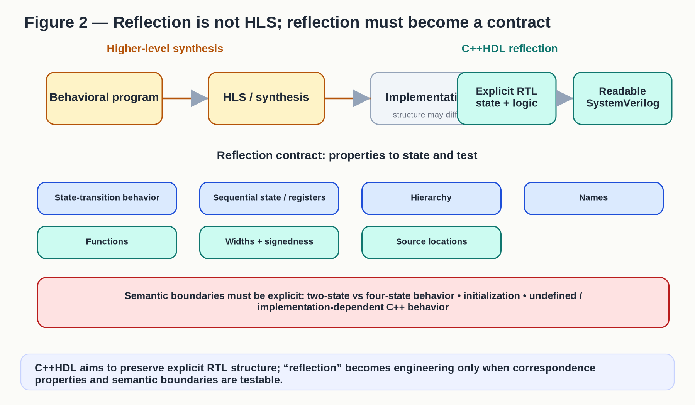

<figure id="figure-2"><figcaption>Figure 2 — Reflection is not HLS; reflection must become a contract</figcaption>
<a href="figures/figure-2.svg">Vector source</a>

Published figure text
<ul><li>Figure 2 — Reflection is not HLS; reflection must become a contract</li><li>Higher-level synthesis</li><li>Behavioral program</li><li>HLS / synthesis</li><li>Implementation</li><li>structure may differ</li><li>C++HDL reflection</li><li>Explicit RTL</li><li>state + logic</li><li>Readable</li><li>SystemVerilog</li><li>Reflection contract: properties to state and test</li><li>State-transition behavior</li><li>Sequential state / registers</li><li>Hierarchy</li><li>Names</li><li>Functions</li><li>Widths + signedness</li><li>Source locations</li><li>Semantic boundaries must be explicit: two-state vs four-state behavior • initialization • undefined /</li><li>implementation-dependent C++ behavior</li><li>C++HDL aims to preserve explicit RTL structure; “reflection” becomes engineering only when correspondence</li><li>properties and semantic boundaries are testable.</li></ul>
</figure>

Figure 2. C++HDL aims to preserve explicit RTL structure; “reflection” becomes engineering only when correspondence properties and semantic boundaries are testable.

### A real reflection you can inspect

Reznikov’s public repository gives us a real example rather than a cartoon [5–7]. examples/basic/Buffer.cpp declares explicit ports and register state. One state element is easy to follow across the boundary:

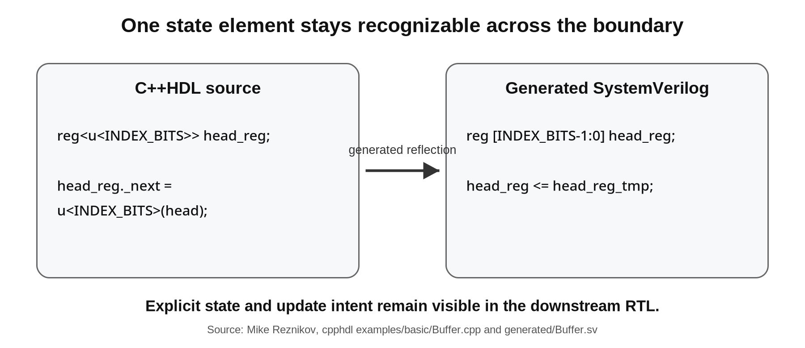

<figure id="figure-2a"><figcaption>One state element stays recognizable across the boundary</figcaption>

Published figure text
<ul><li>One state element stays recognizable across the boundary</li><li>C++HDL source</li><li>reg&lt;u&lt;INDEX_BITS&gt;&gt; head_reg;</li><li>head_reg.next = u&lt;INDEX_BITS&gt;(head);</li><li>Generated SystemVerilog</li><li>reg [INDEX_BITS-1:0] head_reg;</li><li>head_reg &lt;= head_reg_tmp;</li><li>Explicit state and update intent remain visible in the downstream RTL.</li><li>Source: Mike Reznikov, cpphdl examples/basic/Buffer.cpp and generated/Buffer.sv</li></ul>
</figure>

Figure 2A. Reznikov’s Buffer example shows one explicit state element remaining recognizable from executable C++HDL into generated SystemVerilog [6,7].

Tail and count state follow the same pattern, and the C++ combinational helpers become named always\_comb blocks. The inline test can run either the native C++ Buffer or a Verilator model. This is not proof of universal equivalence. It is direct evidence of the intended architecture: executable C++ RTL, recognizable SystemVerilog reflection, and dual-domain checking.

Reflection needs a written acceptance contract. For the supported domain, say what must match—ports, state, widths and signedness, declared hierarchy or names, and cycle-level observable behavior—and say where differences such as two-state versus four-state semantics are allowed and checked. For downstream use, also say what names or source locations are expected to remain traceable. An unexplained observable mismatch inside that contract is a failure. Once understood, it becomes a permanent regression test.

## A serious lineage

C++HDL enters an old argument, not an empty field. That history does three useful things: it tells us what isn’t new, gives the earlier engineers their due, and reminds us that an attractive C/C++ hardware flow still has to survive the reasons earlier versions never became the dominant RTL path.

One clear early line runs through C Level Design, founded in 1996 by Don Soderman, Denis Coleman, and Yuri Panchul. In 1998, Soderman and Panchul published two IEEE papers on C2Verilog, including a full-featured ANSI C-to-synthesizable-RTL-Verilog compiler [14,15]. Contemporary coverage named Hitachi, Fujitsu, Motorola, NASA, and Minolta as customers [18]. C-to-RTL compilation was already serious industrial work, not a resemblance we invented afterward.

The patent record tells the same story. Yuri Panchul, Donald Soderman, and Denis Coleman are the named inventors on a patent family with priority from September 16, 1997. US 6,226,776 describes converting C-type hardware descriptions into synthesizable RTL HDL; a continuation issued as US 6,848,085 [16,17]. Stephen Edwards later called the patent broad, and C Level CEO Dan Skilken called it a landmark patent for high-level-language-to-HDL synthesis [12,24]. A tip of the hat to Yuri Panchul for raising awareness of that legacy in a LinkedIn comment [8].

C Level’s later products add related but distinct evidence. By 2000, System Compiler accepted C or C++ hardware descriptions and produced RTL Verilog or VHDL [9]. CycleC supplied a cycle-accurate ANSI C/C++ style with concurrency, hierarchy, clocks, and resets that could run through an ordinary compiler [9]. In 2001, C Level announced plans to contribute CycleC to OSCI and Accellera [10,22], but the transfer did not complete before the company ceased operation. Synopsys acquired the CycleC and System Compiler technology assets later that year and integrated CycleC technology into VCS [11,12]. The compiler, the cycle-accurate methodology, and the patents are related, but they are not the same thing.

A separate industrial branch comes even closer. A 2002 DAC paper by Luc Séméria and colleagues describes work at Clearwater Networks, formerly XStream Logic [13,23]. Bit-accurate RTL C/C++ was the design entry. The flow generated Verilog, checked it against the C golden model through an independent translation and formal-equivalence path, then sent the checked Verilog into the standard ASIC flow. The paper also names CycleC and Cynergy RTL-C among earlier commercial C/C++ styles and thanks C Level engineers. That is strong precedent for the combination of executable RTL source, generated Verilog, cross-domain checking, and conventional downstream implementation.

ArchHDL is not the beginning of this story; it is a later C++-specific member of it [26–28]. MyHDL, PyMTL, ROHD, Gatery, and Verilator add other variations [29–33]. Figure 3 compresses the lineage: C2Verilog/System Compiler shows early C/C++-to-RTL compilation; CycleC shows native cycle-accurate C/C++ execution; the Panchul–Soderman–Coleman patents document the compiler lineage; and XStream/Clearwater shows a production RTL-C flow with formal equivalence before the standard ASIC flow.

The broader historical picture also holds up well. A 1998 EE Times report named both Hitachi and Motorola as C2Verilog customers [18]. Motorola engineers published that year on algorithmic, bit-accurate, and cycle-accurate C models used with HDL design and verification [20]. Clearwater Networks was formerly XStream Logic [23]. We have not reconstructed every company’s internal coding style, and we should not pretend the systems were identical. They don’t need to be. The record already establishes a deep, plural lineage.

That history also gives us a warning. C-like hardware flows did not displace Verilog and VHDL as mainstream RTL. Edwards’ 2005 survey identified concurrency and timing control as fundamental challenges, while contemporary reporting found C very useful for modeling and exploration but much less routine as a direct path into production RTL [24,25]. AI changes one important variable: who sits inside the edit-build-test loop. It does not automatically solve semantic trust, timing, downstream PPA, standards, source traceability, or switching cost. That is why the semantic attack, Verilator baseline, matched PPA budget, migration test, and maintenance test are central to the argument, not caveats.

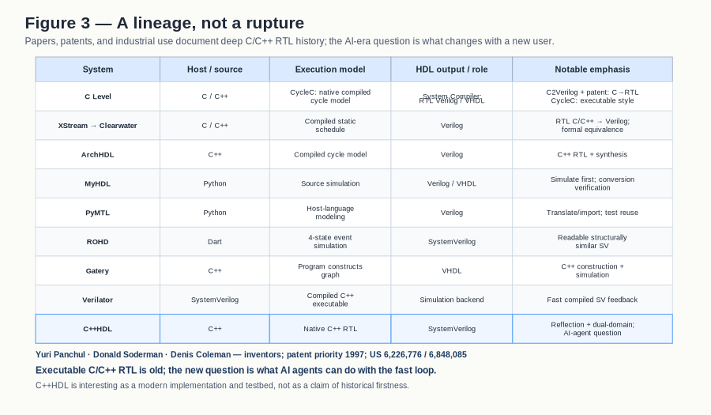

<figure id="figure-3"><figcaption>Figure 3 — A lineage, not a rupture</figcaption>
<a href="figures/figure-3.svg">Vector source</a>

Published figure text
<table><tbody><tr><th>System</th><th>Host / source</th><th>Execution model</th><th>HDL output / role</th><th>Notable emphasis</th></tr><tr><td>C Level</td><td>C / C++</td><td>CycleC: native compiled cycle model</td><td>System Compiler: RTL Verilog / VHDL</td><td>C2Verilog + patent: C→RTL CycleC: executable style</td></tr><tr><td>XStream → Clearwater</td><td>C / C++</td><td>Compiled static schedule</td><td>Verilog</td><td>RTL C/C++ → Verilog; formal equivalence</td></tr><tr><td>ArchHDL</td><td>C++</td><td>Compiled cycle model</td><td>Verilog</td><td>C++ RTL + synthesis</td></tr><tr><td>MyHDL</td><td>Python</td><td>Source simulation</td><td>Verilog / VHDL</td><td>Simulate first; conversion verification</td></tr><tr><td>PyMTL</td><td>Python</td><td>Host-language modeling</td><td>Verilog</td><td>Translate/import; test reuse</td></tr><tr><td>ROHD</td><td>Dart</td><td>4-state event simulation</td><td>SystemVerilog</td><td>Readable structurally similar SV</td></tr><tr><td>Gatery</td><td>C++</td><td>Program constructs graph</td><td>VHDL</td><td>C++ construction + simulation</td></tr><tr><td>Verilator</td><td>SystemVerilog</td><td>Compiled C++ executable</td><td>Simulation backend</td><td>Fast compiled SV feedback</td></tr><tr><td>C++HDL</td><td>C++</td><td>Native C++ RTL</td><td>SystemVerilog</td><td>Reflection + dual-domain; AI-agent question</td></tr></tbody></table><ul><li>Figure 3 — A lineage, not a rupture</li><li>Papers, patents, and industrial use document deep C/C++ RTL history; the AI-era question is what changes with a new user.</li><li>System</li><li>Host / source</li><li>Execution model</li><li>HDL output / role</li><li>Notable emphasis</li><li>C Level</li><li>C / C++</li><li>CycleC: native compiled</li><li>cycle model</li><li>System Compiler:</li><li>RTL Verilog / VHDL</li><li>C2Verilog + patent: C→RTL</li><li>CycleC: executable style</li><li>XStream → Clearwater</li><li>C / C++</li><li>Compiled static</li><li>schedule</li><li>Verilog</li><li>RTL C/C++ → Verilog;</li><li>formal equivalence</li><li>ArchHDL</li><li>C++</li><li>Compiled cycle model</li><li>Verilog</li><li>C++ RTL + synthesis</li><li>MyHDL</li><li>Python</li><li>Source simulation</li><li>Verilog / VHDL</li><li>Simulate first; conversion</li><li>verification</li><li>PyMTL</li><li>Python</li><li>Host-language</li><li>modeling</li><li>Verilog</li><li>Translate/import; test reuse</li><li>ROHD</li><li>Dart</li><li>4-state event</li><li>simulation</li><li>SystemVerilog</li><li>Readable structurally</li><li>similar SV</li><li>Gatery</li><li>C++</li><li>Program constructs</li><li>graph</li><li>VHDL</li><li>C++ construction +</li><li>simulation</li><li>Verilator</li><li>SystemVerilog</li><li>Compiled C++</li><li>executable</li><li>Simulation backend</li><li>Fast compiled SV feedback</li><li>C++HDL</li><li>C++</li><li>Native C++ RTL</li><li>SystemVerilog</li><li>Reflection + dual-domain;</li><li>AI-agent question</li><li>Yuri Panchul · Donald Soderman · Denis Coleman — inventors; patent priority 1997; US 6,226,776 / 6,848,085</li><li>Executable C/C++ RTL is old; the new question is what AI agents can do with the fast loop.</li><li>C++HDL is interesting as a modern implementation and testbed, not as a claim of historical firstness.</li></ul>
</figure>

Figure 3. A family of executable C/C++ RTL approaches has deep prior lineage; C++HDL’s most interesting question is what changes when AI agents become participants in the fast development loop. The matrix distinguishes C Level’s C2Verilog/System Compiler, CycleC, and the Panchul–Soderman–Coleman patent family, then follows the lineage through XStream Logic/Clearwater’s 2002 RTL-C methodology and later systems including ArchHDL, ROHD, Verilator, and C++HDL.

## The development habitat matters

If C++HDL were only another syntax for SystemVerilog, its importance would be limited.

Its deeper attraction is that the RTL can live in the ordinary C++ development environment.

That changes what is cheap. The designer can compile quickly, use ordinary debuggers, unit-test frameworks, sanitizers, profilers, libraries, build systems, and software instrumentation, and run software workloads directly against the RTL model. Small experiments can stay inside an ecosystem built for fast edit-compile-run-debug cycles instead of crossing a language or simulator boundary every time.

This doesn’t mean SystemVerilog has to imply a slow development loop. Verilator is the important counterexample: it compiles SystemVerilog into executable C++ or SystemC, supports C++ test harnesses and profiling, and is built for fast compiled simulation [33]. Reznikov has publicly grouped Verilator and cpphdl together as fast alternatives to commercial simulation [3].

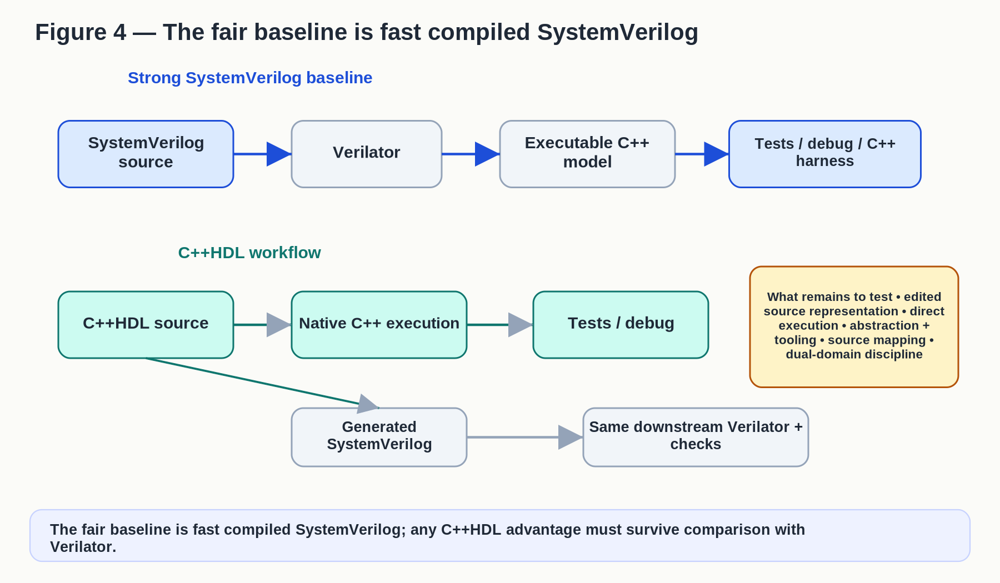

<figure id="figure-4"><figcaption>Figure 4 — The fair baseline is fast compiled SystemVerilog</figcaption>
<a href="figures/figure-4.svg">Vector source</a>

Published figure text
<ul><li>Figure 4 — The fair baseline is fast compiled SystemVerilog</li><li>Strong SystemVerilog baseline</li><li>SystemVerilog</li><li>source</li><li>Verilator</li><li>Executable C++</li><li>model</li><li>Tests / debug / C++</li><li>harness</li><li>C++HDL workflow</li><li>C++HDL source</li><li>Native C++ execution</li><li>Tests / debug</li><li>Generated</li><li>SystemVerilog</li><li>Same downstream Verilator +</li><li>checks</li><li>What remains to test • edited</li><li>source representation • direct</li><li>execution • abstraction +</li><li>tooling • source mapping •</li><li>dual-domain discipline</li><li>The fair baseline is fast compiled SystemVerilog; any C++HDL advantage must survive comparison with</li><li>Verilator.</li></ul>
</figure>

Figure 4. The fair baseline is fast compiled SystemVerilog; any C++HDL advantage must survive comparison with Verilator.

The faster environment can support exploration, debugging, tests, and repeated local experiments. SystemVerilog remains available for independent simulation, lint, formal analysis, synthesis, timing, physical design, and signoff. The two domains can be complementary rather than competitive.

That may be the most practical strength of Reznikov’s approach: move the development loop without moving the industry boundary.

## Why the computational actor matters

This is where Reznikov’s contribution becomes especially interesting. Earlier C/C++ RTL efforts were aimed primarily at human design teams seeking faster simulation, more convenient modeling, synthesis, or co-verification. Reznikov has explicitly described writing RTL in C++ with Claude and Codex and getting faster iterations, and he has proposed C++HDL as an intermediate AI-friendly representation of RTL [3,4]. Those observations are his and deserve direct credit.

An AI agent may change the value of an old architecture because it can exploit cheap feedback more aggressively than a human can. There are at least two plausible reasons. One is familiarity: frontier coding models have seen a great deal of C and C++, compilers, tests, build systems, debuggers, and software-development patterns. The other is feedback cost. An agent can make a small change, compile immediately, run a focused test, inspect a precise failure, instrument state, and try again. Which reason matters more is an experimental question.

The second reason isn’t really about syntax. It’s about feedback economics.

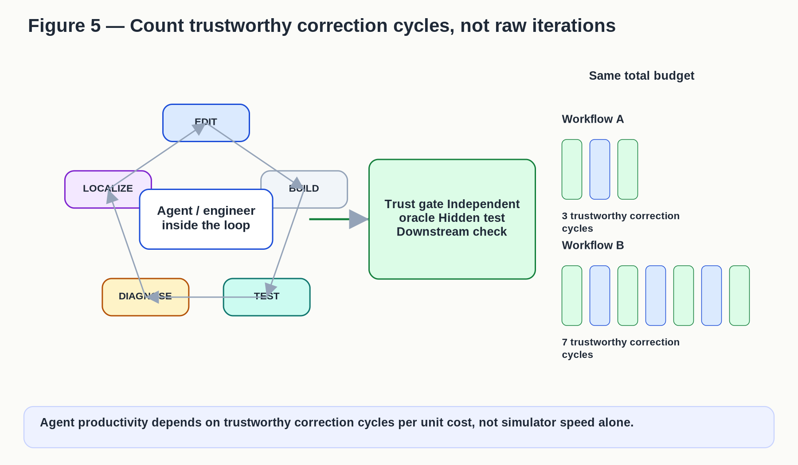

<figure id="figure-5"><figcaption>Figure 5 — Count trustworthy correction cycles, not raw iterations</figcaption>
<a href="figures/figure-5.svg">Vector source</a>

Published figure text
<ul><li>Figure 5 — Count trustworthy correction cycles, not raw iterations</li><li>EDIT</li><li>BUILD</li><li>TEST</li><li>DIAGNOSE</li><li>LOCALIZE</li><li>Agent / engineer</li><li>inside the loop</li><li>Trust gate  Independent</li><li>oracle Hidden test</li><li>Downstream check</li><li>Same total budget</li><li>Workflow A</li><li>3 trustworthy correction</li><li>cycles</li><li>Workflow B</li><li>7 trustworthy correction</li><li>cycles</li><li>Agent productivity depends on trustworthy correction cycles per unit cost, not simulator speed alone.</li></ul>
</figure>

Figure 5. Agent productivity depends on trustworthy correction cycles per unit cost, not simulator speed alone.

If one representation gives an agent ten trustworthy correction cycles in the time another gives it one, that can change the search process even if the language itself isn’t easier. A fast loop lets the agent test more hypotheses, recover from more mistakes, and spend more of its budget interacting with evidence instead of waiting for heavyweight tools.

Reznikov’s AI-friendly-RTL idea raises a deeper question.

## What his work makes us wonder

From here on, the ideas are our extrapolations from Reznikov’s work, not claims we attribute to him.

Our central hypothesis is not that C++ has suddenly become a better HDL. It is that an old executable-RTL architecture may become more valuable when an AI agent can turn cheap, trustworthy feedback into more correction, more search, and more tested alternatives per unit budget.

That suggests three related engineering questions.

First, does C++HDL actually improve an AI agent’s ability to produce correct RTL, or does it merely make individual simulations faster?

Second, if there is an advantage, how much comes from the representation itself and how much comes from the cheap native execution loop?

Third, can the faster loop change not only coding productivity but the amount of design-space search that is economically possible?

These questions can be tested.

## Experiment 1: attack the reflection boundary

The more attractive the native C++ loop becomes, the more dangerous any mismatch with generated SystemVerilog becomes.

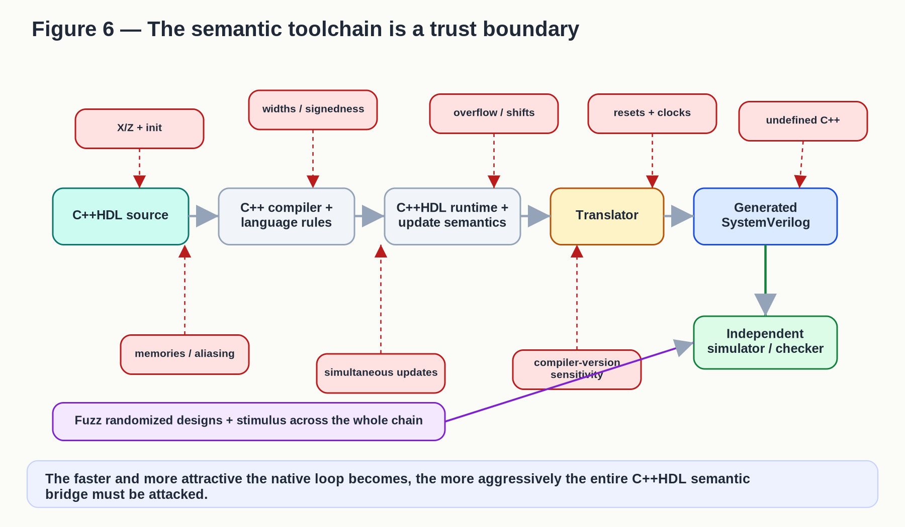

<figure id="figure-6"><figcaption>Figure 6 — The semantic toolchain is a trust boundary</figcaption>
<a href="figures/figure-6.svg">Vector source</a>

Published figure text
<ul><li>Figure 6 — The semantic toolchain is a trust boundary</li><li>C++HDL source</li><li>C++ compiler +</li><li>language rules</li><li>C++HDL runtime +</li><li>update semantics</li><li>Translator</li><li>Generated</li><li>SystemVerilog</li><li>Independent</li><li>simulator / checker</li><li>X/Z + init</li><li>widths / signedness</li><li>overflow / shifts</li><li>resets + clocks</li><li>undefined C++</li><li>memories / aliasing</li><li>simultaneous updates</li><li>compiler-version</li><li>sensitivity</li><li>Fuzz randomized designs + stimulus across the whole chain</li><li>The faster and more attractive the native loop becomes, the more aggressively the entire C++HDL semantic</li><li>bridge must be attacked.</li></ul>
</figure>

Figure 6. The faster and more attractive the native loop becomes, the more aggressively the entire C++HDL semantic bridge must be attacked.

The first serious experiment should try to break it. Use randomized designs and stimulus aimed at the boundaries in Figure 6: initialization, state modeling, widths and signedness, reset and clock behavior, memories, ordering, and C++ behavior that may be undefined or implementation-dependent. Where practical, repeat the campaign across supported C++ compilers, versions, and optimization modes. State the acceptance boundary explicitly—for example, two-state RTL plus declared checks at the four-state boundary rather than universal C++/SystemVerilog semantic identity.

Run the native C++ model and generated SystemVerilog on the same input histories and compare observable state cycle by cycle.

The goal is not to demonstrate a few successful examples. It is to make the two worlds disagree.

Every mismatch should become a permanent regression. If a large hostile campaign still finds no disagreement, confidence has been earned rather than assumed. If whole classes of disagreement appear, they reveal the method’s real boundary.

## Experiment 2: decompose the AI advantage

The most informative AI experiment needs three arms, not two. They provide a causal decomposition, not perfect causal isolation: changing the representation can also change diagnostics, source mapping, prompt length, action space, and what the model has seen during training.

A. Direct SystemVerilog development using a strong compiled-feedback workflow, preferably Verilator with a C++ harness, modern build caching, lint, and the same hidden tests used elsewhere.

B. C++HDL with its native C++ compile/test/debug loop enabled, followed by generated SystemVerilog checked through the same downstream Verilator and acceptance flow.

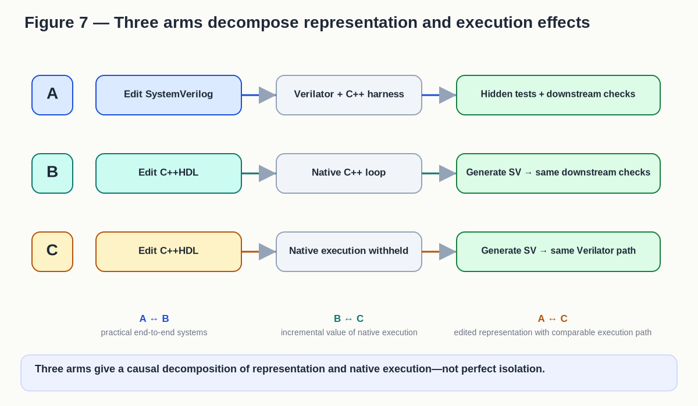

<figure id="figure-7"><figcaption>Figure 7 — Three arms decompose representation and execution effects</figcaption>
<a href="figures/figure-7.svg">Vector source</a>

Published figure text
<ul><li>Figure 7 — Three arms decompose representation and execution effects</li><li>A</li><li>Edit SystemVerilog</li><li>Verilator + C++ harness</li><li>Hidden tests + downstream checks</li><li>B</li><li>Edit C++HDL</li><li>Native C++ loop</li><li>Generate SV → same downstream checks</li><li>C</li><li>Edit C++HDL</li><li>Native execution withheld</li><li>Generate SV → same Verilator path</li><li>A ↔ B</li><li>practical end-to-end systems</li><li>B ↔ C</li><li>incremental value of native execution</li><li>A ↔ C</li><li>edited representation with comparable execution path</li><li>Three arms give a causal decomposition of representation and native execution—not perfect isolation.</li></ul>
</figure>

Figure 7. Three experimental arms provide a stronger causal decomposition of representation and native-execution effects than a two-way benchmark can.

Use several task families and fresh agent contexts. Randomize task-to-arm assignment where practical, and freeze hidden acceptance tests before the run. Hold end-to-end budgets, downstream tools, and hardware targets constant. Log exactly what each agent can observe and do. If feasible, repeat the study with more than one model or agent family. Independently lint, simulate, and synthesize the final SystemVerilog.

The primary outcomes are final correctness, robustness on hidden cases, wall-clock time, total compute and tool cost, human rescue, and final PPA. Also measure translation and incremental-build latency, edit-test-debug cycles, model tokens, tool calls, diagnostic quality, and time to trace failures back to the edited source. Trustworthy correction cycles per unit cost may explain a result; it is not the sole scoreboard.

The third arm matters because a simple C++HDL-versus-SystemVerilog comparison can’t tell us what caused a win. A versus B compares the practical end-to-end systems. B versus C estimates the added value of native execution inside C++HDL. A versus C asks whether editing in C++HDL helps when both arms ultimately run through a comparable SystemVerilog/Verilator path. If all three are similar, the AI story should narrow.

## Experiment 3: ask whether cheap RTL execution changes search

The bigger possibility is not that an agent writes one block faster. It is that the agent can explore more hardware alternatives before the budget runs out.

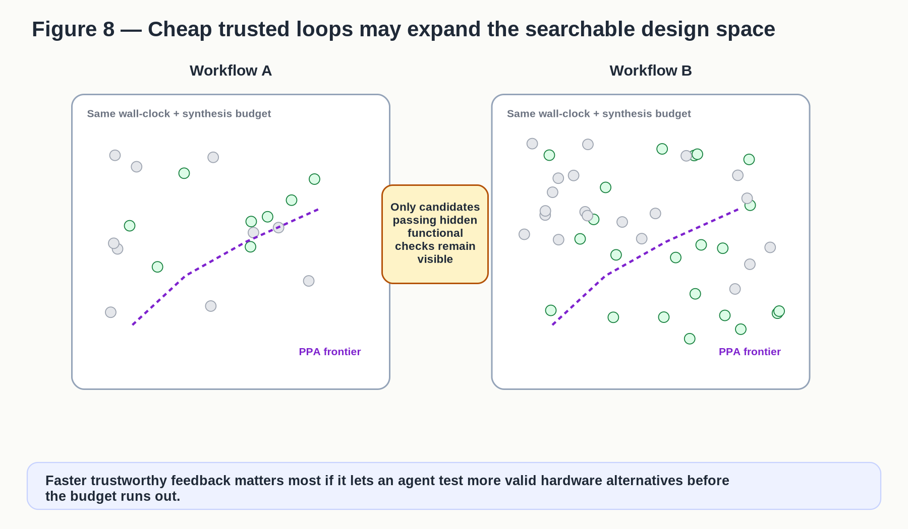

<figure id="figure-8"><figcaption>Figure 8 — Cheap trusted loops may expand the searchable design space</figcaption>
<a href="figures/figure-8.svg">Vector source</a>

Published figure text
<ul><li>Figure 8 — Cheap trusted loops may expand the searchable design space</li><li>Workflow A</li><li>Same wall-clock + synthesis budget</li><li>PPA frontier</li><li>Workflow B</li><li>Same wall-clock + synthesis budget</li><li>PPA frontier</li><li>Only candidates</li><li>passing hidden</li><li>functional</li><li>checks remain</li><li>visible</li><li>Faster trustworthy feedback matters most if it lets an agent test more valid hardware alternatives before</li><li>the budget runs out.</li></ul>
</figure>

Figure 8. Faster trustworthy feedback matters most if it lets an agent test more valid hardware alternatives before the budget runs out.

Then compare how many candidates survive both hidden functional checks and the chosen downstream PPA evaluation, how long it takes to reach a good Pareto frontier, and the final spread of power, performance, and area. Candidate generation alone does not count as useful search. If synthesis, STA, formal, or physical evaluation dominates the matched end-to-end budget, that is the result: the bottleneck is elsewhere. Faster native RTL execution may not move the Pareto frontier, and the claim should narrow accordingly.

A cheap executable RTL loop could matter most here. It might turn hardware generation from “write one plausible design and repair it” into a genuinely iterative search.

## Experiment 4: separate migration from maintenance

Greenfield elegance is not enough. The earlier C/C++ RTL wave is also a reminder that adoption is not a syntax contest: standards, verification infrastructure, tool support, switching cost, and organizational confidence matter. Migration and maintenance are different questions and should not be conflated.

Migration asks what it costs to move an established SystemVerilog block into C++HDL while preserving behavior and downstream compatibility. The real block brings its history with it: lint waivers, CDC/RDC constraints, assertions, interface conventions, debug scripts, and more.

Maintenance starts only after both representations and their mappings are established. Then make realistic changes: add a mode, widen a structure, change reset behavior, or fix a protocol corner case.

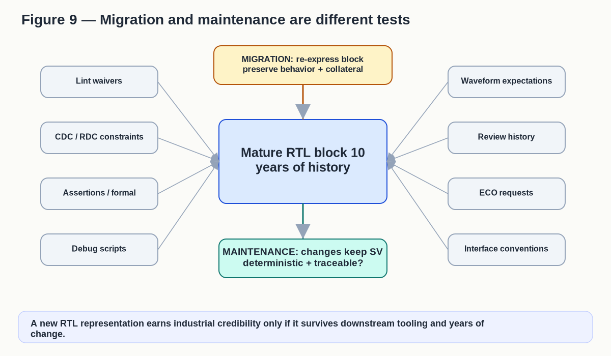

<figure id="figure-9"><figcaption>Figure 9 — Migration and maintenance are different tests</figcaption>
<a href="figures/figure-9.svg">Vector source</a>

Published figure text
<ul><li>Figure 9 — Migration and maintenance are different tests</li><li>Mature RTL block 10</li><li>years of history</li><li>Lint waivers</li><li>CDC / RDC constraints</li><li>Assertions / formal</li><li>Debug scripts</li><li>Waveform expectations</li><li>Review history</li><li>ECO requests</li><li>Interface conventions</li><li>MIGRATION: re-express block</li><li>preserve behavior + collateral</li><li>MAINTENANCE: changes keep SV</li><li>deterministic + traceable?</li><li>A new RTL representation earns industrial credibility only if it survives downstream tooling and years of</li><li>change.</li></ul>
</figure>

Figure 9. A new RTL representation earns industrial credibility only if it survives downstream tooling and years of change.

## A practical first test

The first real pilot can be much smaller than the full research program. It should be small enough to reverse and serious enough to fail. Pick one real stateful block with existing SystemVerilog tests and a good Verilator flow. Freeze the specification and hidden tests. Measure the SystemVerilog+Verilator baseline first. Then implement the same block in C++HDL, attack the native and generated models with differential tests, and run the generated SystemVerilog through the same lint, simulation, synthesis, and PPA checks. After that, make the same realistic changes in both workflows—preferably with fresh agent contexts—and compare correctness, elapsed time, total tool and compute cost, human rescue, diagnostic localization, and downstream quality.

Write the stop conditions before the pilot starts. Narrow or stop if important semantic mismatches cannot be bounded, if the generated RTL is too unstable or hard to trace, if good SystemVerilog+Verilator performs just as well, or if downstream synthesis/PPA work dominates so completely that faster native feedback changes nothing useful end to end. Those are answers, not failures.

If the pilot survives, widen the task set and repeat the test. Do not jump straight from one successful block to organizational conversion.

## Why SystemVerilog remains central

None of these experiments needs an anti-SystemVerilog argument.

Quite the opposite.

C++HDL is practical because SystemVerilog already ties together a vast hardware-development ecosystem. The generated SystemVerilog gives engineers and tools an independent representation to inspect. It remains the compatibility boundary for simulation, lint, formal verification, synthesis, timing, physical design, and signoff. It also gives us a second domain for checking whether the C++ execution model is telling the truth.

A good outcome does not require C++ to replace SystemVerilog.

The result may simply be a division of labor: C++HDL, or systems like it, become productive development representations for some work, while SystemVerilog remains the stable shared boundary of the larger hardware flow.

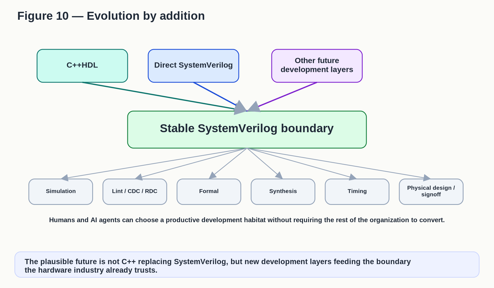

<figure id="figure-10"><figcaption>Figure 10 — Evolution by addition</figcaption>
<a href="figures/figure-10.svg">Vector source</a>

Published figure text
<ul><li>Figure 10 — Evolution by addition</li><li>C++HDL</li><li>Direct SystemVerilog</li><li>Other future</li><li>development layers</li><li>Stable SystemVerilog boundary</li><li>Simulation</li><li>Lint / CDC / RDC</li><li>Formal</li><li>Synthesis</li><li>Timing</li><li>Physical design /</li><li>signoff</li><li>Humans and AI agents can choose a productive development habitat without requiring the rest of the organization to convert.</li><li>The plausible future is not C++ replacing SystemVerilog, but new development layers feeding the boundary</li><li>the hardware industry already trusts.</li></ul>
</figure>

Figure 10. The plausible future is not C++ replacing SystemVerilog, but new development layers feeding the boundary the hardware industry already trusts.

## The strongest reading of Reznikov’s work

History removes the easy novelty story and leaves a more interesting one.

The C2Verilog papers, the Panchul–Soderman–Coleman patents, CycleC, and other C/C++ RTL systems show that executable RTL, native compiled feedback, and C/C++-to-HDL translation have been serious ideas for decades [9,13–17,22]. XStream Logic/Clearwater’s 2002 RTL-C methodology shows that even C-based RTL entry, generated Verilog, formal cross-domain checking, and rejoining the standard ASIC flow are not new as a combination [13,23]. Those are not historical firsts we should assign to Reznikov.

The strongest credit is more specific: Reznikov has made a current, inspectable C++HDL implementation and reflection discipline available [1,5–7], kept the hardware model explicit, preserved readable SystemVerilog and the established downstream toolchain, and pointed directly toward AI agents as users of the fast executable loop [3,4].

The architecture is old. The computational actor is new. That may be where the idea matters most.

If AI agents become important hardware designers, the winning representation may not be the language with the most elegant syntax. It may be the one that gives an agent the fastest trustworthy cycle from hypothesis to executable evidence to correction while still delivering hardware in a form the rest of the industry can trust. If strong SystemVerilog plus Verilator performs just as well, the claim should narrow. If C++HDL produces more trustworthy correction and more useful design search inside the same budget, an old architecture may have acquired a new reason to exist.

Reznikov’s work gives us a concrete system for testing that possibility. That is the research agenda.

## Appendix A — Experimental and Semantic Test Protocols

This appendix turns the paper’s research agenda into something another team could test. Because versions of this architecture have existed before, these protocols are designed to test whether the new computational actor changes enough to matter end to end. It does not claim these experiments have already been run, and it is not yet a frozen benchmark package. Exact task counts, sample sizes, hardware targets, statistics, and the final corpus should be fixed before a real run and reported with the results.

### A.1 Reflection acceptance contract

Reflection needs a written contract before anyone trusts the faster C++ loop.

<table><tbody>
<tr><th><strong>Contract item</strong></th><th><strong>What must hold</strong></th><th><strong>How to check it</strong></th><th><strong>What a failure means</strong></th></tr>
<tr><td><strong>Ports and observable behavior</strong></td><td>For the supported domain, both models receive the same declared inputs and produce the same accepted outputs at the same cycle boundaries.</td><td>Run both models on the same input history and compare cycle by cycle.</td><td>An unexplained in-contract mismatch is a blocker; minimize it and keep it as a regression test.</td></tr>
<tr><td><strong>Sequential state</strong></td><td>Register state, widths, signedness, reset behavior, and update points must correspond; simultaneous updates must preserve next-state semantics.</td><td>Compare instrumented state and outputs where practical.</td><td>A mismatch is a defect unless the contract is explicitly narrowed.</td></tr>
<tr><td><strong>Widths and signedness</strong></td><td>Casts, shifts, overflow, truncation, extension, and host-language promotions must map to the intended RTL behavior.</td><td>Use directed boundary cases and randomized tests.</td><td>Fix the tool or restrict the supported subset; do not dismiss the mismatch.</td></tr>
<tr><td><strong>Clock and reset behavior</strong></td><td>Edges, reset polarity and timing, ordering, and state-commit boundaries must agree.</td><td>Use directed clock/reset sequences and cycle-level traces.</td><td>A mismatch is a semantic defect.</td></tr>
<tr><td><strong>Memories and indexing</strong></td><td>Address/data widths, latency, collision behavior, initialization assumptions, and supported out-of-range behavior must be declared.</td><td>Use directed and randomized access histories.</td><td>Unsupported cases must be named; supported cases must match.</td></tr>
<tr><td><strong>Two-state versus four-state behavior</strong></td><td>The contract must say where native C++ is intentionally two-state and where SystemVerilog four-state behavior is checked.</td><td>Inject X/Z and initialization cases at the declared boundary.</td><td>Inside the contract, a difference is a defect; outside it, the difference is a visible scope limit.</td></tr>
<tr><td><strong>C++ implementation dependence</strong></td><td>Accepted RTL must not depend on undefined C++ behavior; important implementation-defined behavior must be controlled.</td><td>Repeat hostile tests across supported compilers, versions, and optimization modes where practical; use sanitizers and warnings.</td><td>Compiler-sensitive RTL behavior is a trust-boundary defect unless explicitly excluded.</td></tr>
<tr><td><strong>Hierarchy, names, and source mapping</strong></td><td>Generated SystemVerilog must remain traceable enough to relate state, hierarchy, lint/formal findings, waveforms, and synthesis diagnostics back to C++HDL source.</td><td>Compare mappings across generation runs and harmless source edits.</td><td>Unstable or misleading mapping is an industrial-use defect even when simulation passes.</td></tr>
<tr><td><strong>Deterministic generation</strong></td><td>The same source and toolchain should not create gratuitously different SystemVerilog.</td><td>Regenerate and compare normalized output.</td><td>Meaningless churn is a maintenance defect.</td></tr>
</tbody></table>

This is a bounded contract. Passing it earns confidence inside the tested domain; it does not prove universal C++/SystemVerilog semantic identity.

### A.2 Experimental protocols

#### Common controls

Freeze the task specification, hidden tests, hardware target, downstream flow, budgets, primary outcomes, and stop criteria before the run. Record all important tool and model versions. Use fresh agent contexts when prior task knowledge could matter. Randomize task-to-arm assignment where practical. Log exactly what each agent can see and do. Use more than one model or agent family when feasible. Independently check the final SystemVerilog. Report null and negative results, not only wins.

#### A.2.1 Experiment 1 — Attack the reflection boundary

Goal: make the two worlds disagree if they can.

Use hand-built corner cases and generated designs that stress initialization, widths and signedness, resets and clocks, memories, indexing, simultaneous state updates, and risky C++ behavior. Where practical, vary supported compilers, versions, and optimization modes.

Run native C++ and generated SystemVerilog on the same histories. Compare outputs and instrumented state under the written contract. When a mismatch appears, reduce it to the smallest reproducer and keep it forever as a regression.

Measure mismatch classes, semantic coverage, compiler-sensitive cases, minimized regressions, and time to explain a mismatch. Narrow or stop if important disagreements cannot be bounded, the supported subset becomes too weak to matter, or compiler dependence cannot be controlled. A large hostile campaign with no mismatch earns confidence; it does not prove a theorem.

#### A.2.2 Experiment 2 — Decompose the AI advantage

Arm A: edit SystemVerilog and use a strong Verilator/C++-harness workflow with modern build caching, lint, hidden tests, and the common downstream checks.

Arm B: edit C++HDL and use its native C++ loop, then generate SystemVerilog and run the same downstream checks.

Arm C: edit C++HDL but withhold native C++ execution; generate SystemVerilog and use the same Verilator/downstream path as Arm A.

Treat each task-by-agent-run as a comparison unit and repeat across task families. Freeze hidden tests. Match end-to-end budgets and hardware targets. Keep downstream tools constant. Log observations, actions, waits, tool calls, failures, and human rescue. Repeat with other models when feasible.

Primary outcomes are final correctness, hidden-case robustness, wall-clock time, total compute/tool cost, human rescue, and final PPA. Secondary measures include build latency, edit-test-debug cycles, tokens, tool calls, diagnostic quality, source localization, and trustworthy correction cycles per unit cost.

A versus B compares the practical systems. B versus C estimates the added value of native execution inside C++HDL. A versus C asks whether the edited representation helps when both arms ultimately run through a comparable SystemVerilog/Verilator path. This is a causal decomposition, not perfect causal isolation.

Narrow the claim if a good SystemVerilog+Verilator workflow matches C++HDL, if any apparent win disappears under hidden or downstream checks, or if the result depends on one model, prompt, or unequal tool access.

#### A.2.3 Experiment 3 — Does cheap trusted feedback change design search?

Choose a problem with real microarchitectural choices. Give each workflow the same total wall-clock and downstream evaluation budget. Let the agent generate, test, reject, and refine alternatives.

A candidate counts only after it passes frozen functional tests and the chosen downstream PPA gate. Record how many candidates reach each gate, where time is spent, how quickly a useful Pareto frontier appears, and the final power/performance/area distribution.

If synthesis, STA, formal, or physical evaluation consumes the budget and faster native RTL does not improve the surviving frontier, that is the result: the bottleneck is elsewhere.

#### A.2.4 Experiment 4 — Separate migration from maintenance

Migration: take a mature SystemVerilog block with tests, waivers, CDC/RDC constraints, assertions or formal properties, interface conventions, debug scripts, CI, and history. Move it into C++HDL without changing the downstream acceptance target. Measure conversion work, setup/build integration, training, support dependencies, behavior preservation, downstream compatibility, and how easily the team can back out.

Maintenance: after mappings exist, make matched realistic changes in both workflows. Measure implementation time and correctness, deterministic generation, meaningless diff churn, waiver churn, source-map stability, review effort, regression escapes, and whether lint, formal, waveform, and synthesis diagnostics lead back to stable C++HDL source locations.

Narrow or stop if migration cost overwhelms the likely loop benefit, generated RTL is too unstable for normal review and waiver practices, source mapping fails in downstream debug, or maintaining two domains creates more expert work than it removes.

#### A.2.5 Minimum pilot envelope

Start with one real stateful block that already has SystemVerilog tests and a strong Verilator baseline. Freeze the specification and hidden tests. Measure the SystemVerilog baseline first. Build the C++HDL version, attack native and generated models with differential tests, run the generated SystemVerilog through the same downstream checks, then make several matched maintenance changes.

Write semantic, traceability, cost, and downstream stop conditions before starting. The pilot should be small enough to reverse and serious enough to fail. If it survives, widen the test; do not jump from one friendly block to organizational conversion.

### A.3 Worked reflection example: Buffer

The public examples/basic/Buffer.cpp and checked-in examples/basic/generated/Buffer.sv give a compact example of the architecture [6,7]. One state element is easy to trace:

<table><tbody>
<tr><th><strong>Role</strong></th><th><strong>C++HDL</strong></th><th><strong>Generated SystemVerilog</strong></th></tr>
<tr><td><strong>State declaration</strong></td><td>reg&lt;u&lt;INDEX_BITS&gt;&gt; head_reg;</td><td>reg[INDEX_BITS-1:0] head_reg;</td></tr>
<tr><td><strong>Update path</strong></td><td>head_reg._next = u&lt;INDEX_BITS&gt;(head);</td><td>head_reg &lt;= head_reg_tmp;</td></tr>
</tbody></table>

Tail and count state follow the same pattern. The generated code keeps recognizable named state, separates combinational next-state calculation from the clocked commit, and reflects C++ combinational helpers into named combinational logic. The example’s test path can exercise the native C++ Buffer or a Verilator model.

What this shows: explicit RTL state can live in executable C++, remain recognizable in generated SystemVerilog, and be tested in both domains.

What it does not show: safe mapping of every C++ semantic corner; automatic four-state equivalence; stable generated text under every source refactor; or production-quality source mapping and downstream maintenance. Those are the jobs of the contract and experiments above.

Reznikov’s larger RISC-V example describes the same intended pattern: C++ and SystemVerilog versions with the same register set and equal clock waveforms, readable SystemVerilog reflection, and testing in both domains with Verilator [2]. Those are useful reported design goals and workflow properties. They are not substitutes for hostile independent testing.

## References

[1] Mike Reznikov. [“Designing RTL with C++HDL.”](https://lnkd.in/p/gM6bBGXw) LinkedIn document, September 12, 2026.

[2] Mike Reznikov. “[RISC-V CPU draft in C++HDL.](https://www.linkedin.com/pulse/risc-v-cpu-draft-chdl-mike-reznikov-m0vmf)” LinkedIn, February 7, 2026.

[3] Mike Reznikov. Public comment on Vlad Feldman, “[Why hardware engineers should pay attention to AI agents now](https://www.linkedin.com/posts/vladfeldman_why-hardware-engineers-should-pay-attention-activity-7457475163568193536-JzkE),” describing RTL development in C++ with Claude/Codex and faster iterations. LinkedIn, 2026.

[4] Mike Reznikov. Public comment on Mark H. Ren’s [Agentrys funding post](https://www.linkedin.com/posts/mark-h-ren-4837318_agentrys-raises-245-million-to-build-agentic-activity-7498390180228268032-ckFR) suggesting C++HDL as an intermediate AI-friendly RTL representation. LinkedIn, 2026.

[5] Mike Reznikov. [cpphdl repository](https://github.com/mirekez/cpphdl).

[6] Mike Reznikov. [cpphdl examples/basic/Buffer.cpp](https://github.com/mirekez/cpphdl/blob/main/examples/basic/Buffer.cpp), native C++HDL Buffer example with inline native/Verilator test path.

[7] Mike Reznikov. [cpphdl examples/basic/generated/Buffer.sv](https://github.com/mirekez/cpphdl/blob/main/examples/basic/generated/Buffer.sv), checked-in generated SystemVerilog for the Buffer example.

[8] Yuri Panchul. Public comment on Mike Reznikov’s “Designing RTL with C++HDL,” LinkedIn, September 13, 2026.

[9] Peter Clarke. “[C Level refines System Compiler, CSim tool.](https://www.eetimes.com/c-level-refines-system-compiler-csim-tool/)” EE Times, May 22, 2000.

[10] Richard Goering. “[C Level backs SystemC, but license tiff remains.](https://www.eetimes.com/c-level-backs-systemc-but-license-tiff-remains/)” EE Times, March 12, 2001.

[11] EE Times. “[Synopsys acquires technology assets from C Level Design.](https://www.eetimes.com/synopsys-acquires-technology-assets-from-c-level-design/)” November 12, 2001.

[12] Richard Goering. “[C Level folds, Synopsys buys its assets.](https://www.edn.com/c-level-folds-synopsys-buys-its-assets/)” EDN, November 12, 2001. Includes Dan Skilken’s description of the “Panchul patent” as a landmark patent for high-level-language-to-HDL synthesis.

[13] Luc Séméria, Andrew Seawright, Renu Mehra, Daniel Ng, Arjuna Ekanayake, and Barry Pangrle. “[RTL C-Based Methodology for Designing and Verifying a Multi-Threaded Processor.](https://doi.org/10.1145/513918.513951)” DAC 2002, pp. 123–128.

[14] Donald Soderman and Yuri Panchul. “[Implementing C Designs in Hardware: A Full-Featured ANSI C to RTL Verilog Compiler in Action.](https://doi.org/10.1109/IVC.1998.660676)” International Verilog HDL Conference / VHDL International Users Forum, 1998, pp. 22–29.

[15] Donald Soderman and Yuri Panchul. “[Implementing C Algorithms in Reconfigurable Hardware Using C2Verilog.](https://doi.org/10.1109/FPGA.1998.707944)” IEEE Symposium on FPGAs for Custom Computing Machines, 1998, pp. 339–342.

[16] Yuri V. Panchul, Donald A. Soderman, and Denis R. Coleman. US Patent 6,226,776, “[System for converting hardware designs in high-level programming language to hardware implementations.](https://patents.google.com/patent/US6226776B1/en)” Filed September 16, 1997; issued May 1, 2001.

[17] Yuri Panchul, Donald Soderman, and Denis Coleman. US Patent 6,848,085, “[System for converting hardware designs in high-level programming languages to hardware implementations.](https://patents.google.com/patent/US6848085B2/en)” Continuation filed April 30, 2001; issued January 25, 2005.

[18] Richard Goering. “[C Level Design tackles C-to-HDL.](https://www.eetimes.com/c-level-design-tackles-c-to-hdl/)” EE Times, December 14, 1998.

[19] EE Times. “[C Level Design Adds RTL-C Synthesis Product to SLDA Tool Family.](https://www.eetimes.com/c-level-design-adds-rtl-c-synthesis-product-to-slda-tool-family/)” March 16, 1999.

[20] Tom Balph and Pat O’Malley, Motorola Semiconductor. “[C modeling accelerates HDL-system design.](https://www.edn.com/10-22-98-c-modeling-accelerates-hdl-system-desig/)” EDN, October 22, 1998.

[21] Crista Souza. “[Altera takes stake in C Level Design to streamline IC-design automation.](https://www.eetimes.com/altera-takes-stake-in-c-level-design-to-streamline-ic-design-automation/)” EE Times, June 6, 2000.

[22] C Level Design. “[C Level Design Donates CycleC Methodology to Open SystemC Initiative.](https://www.eetimes.com/c-level-design-donates-cyclec-methodology-to-open-systemc-initiative/)” EE Times, March 19, 2001.

[23] Craig Matsumoto. “[Network processor aims at adjunct role.](https://www.eetimes.com/network-processor-aims-at-adjunct-role/)” EE Times, June 12, 2001. Identifies Clearwater Networks as formerly XStream Logic.

[24] Stephen A. Edwards. “[The Challenges of Hardware Synthesis from C-Like Languages.](https://www.cs.columbia.edu/~sedwards/papers/edwards2005challenges.pdf)” DATE 2005. Surveys C-like hardware synthesis, including C2Verilog; describes the Panchul–Soderman–Coleman patent as broad; and identifies concurrency and timing control as fundamental challenges.

[25] Ronald Wilson. “[C link remains frayed in hardware design flows.](https://www.eetimes.com/c-link-remains-frayed-in-hardware-design-flows/)” EE Times, October 17, 2005. Reports how practicing teams were using C for modeling, verification, and selective synthesis, while describing persistent difficulty moving C directly into production RTL.

[26] Shimpei Sato and Kenji Kise. “[ArchHDL: A New Hardware Description Language for High-Speed Architectural Evaluation.](https://doi.org/10.1109/MCSoC.2013.38)” IEEE MCSoC, 2013.

[27] Shimpei Sato and Kenji Kise. “[ArchHDL: A Novel Hardware RTL Development Environment in C++.](https://doi.org/10.1007/978-3-319-16214-0_5)” ARC, 2015.

[28] Shimpei Sato, Ryohei Kobayashi, and Kenji Kise. “[ArchHDL: A Novel Hardware RTL Modeling and High-Speed Simulation Environment.](https://doi.org/10.1587/transinf.2017RCP0012)” IEICE Transactions on Information and Systems, 2018.

[29] Jan Decaluwe and the MyHDL community. MyHDL conversion and conversion-verification documentation.

[30] Derek Lockhart, Gary Zibrat, and Christopher Batten. “PyMTL: A Unified Framework for Vertically Integrated Computer Architecture Research.” MICRO, 2014.

[31] [ROHD project documentation](https://intel.github.io/rohd-website/get-started/overview/).

[32] Synogate. [Gatery documentation and tutorials](https://www.synogate.com/gatery/tutorial/part1.html).

[33] [Verilator 5.052 documentation](https://verilator.org/guide/latest/overview.html).

[34] Mingjie Liu, Nathaniel Pinckney, Brucek Khailany, and Haoxing Ren. “VerilogEval: Evaluating Large Language Models for Verilog Code Generation.” ICCAD, 2023.

[35] Yun-Da Tsai, Mingjie Liu, and Haoxing Ren. “[RTLFixer: Automatically Fixing RTL Syntax Errors with Large Language Models.](https://arxiv.org/abs/2311.16543)” arXiv:2311.16543, 2023; ACM/IEEE DAC, 2024.
